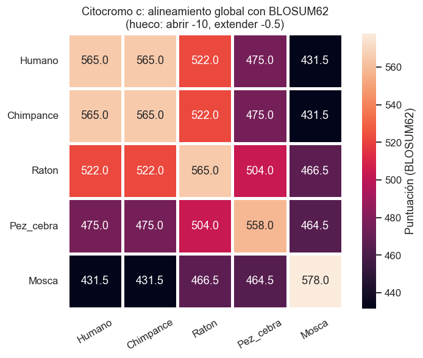

# Práctica 2 · Ejercicio 2: alineamiento todos contra todos del citocromo c

Alineamiento global por pares de la misma proteína (el **citocromo c**) en cinco especies
(humano, chimpancé, ratón, pez cebra y mosca) con `Bio.Align.PairwiseAligner`. Las 25
puntuaciones se guardan en un DataFrame, se dibujan como *heatmap* y se comparan siete
matrices de sustitución.

**Para corregir:** [`practica2_ejercicio2.ipynb`](practica2_ejercicio2.ipynb) contiene el
ejercicio ya ejecutado, con explicaciones, gráficos y comentarios de los resultados.



## Requisitos

- Python 3.9 o superior

```bash
pip install -r requirements.txt
jupyter notebook practica2_ejercicio2.ipynb
```

El notebook no necesita internet: las secuencias ya están en `data/citocromo_c.fasta`.
Para volver a descargarlas de UniProt:

```bash
python descargar_secuencias.py
```

## Qué hay en el notebook

| Sección | Contenido |
|---|---|
| 1. Carga | `SeqIO.parse` del FASTA con las 5 especies |
| 2. Todos contra todos | Bucle de 5 × 5 con `aligner.score()`, global, BLOSUM62, huecos -10 / -0.5 |
| 3. Heatmap | Matriz de puntuaciones con Seaborn y comentario |
| 4. Normalización *(extra)* | `S(a,b) / √(S(a,a)·S(b,b))` y % de identidad |
| 5. Alineamiento humano–mosca *(extra)* | Conservación del motivo CXXCH y de Met80, que sujetan el hemo |
| 6. Otras matrices | BLOSUM45/62/80/90 y PAM30/70/250, heatmaps normalizados y correlación de Spearman entre rankings |
| 7. Árbol *(extra)* | UPGMA sobre `1 − S_norm` |
| 8. Huecos en los extremos *(extra)* | Efecto de `end_gap_score = 0` |
| 9. Conclusiones | |

## Resultados principales

- El citocromo c de humano y chimpancé es **idéntico**. Con la mosca, el humano comparte
  un ~74 % de identidad, y los residuos que fijan el hemo se conservan en todas las
  especies.
- La puntuación baja con la distancia evolutiva (chimpancé > ratón > pez > mosca).
- El ratón está más cerca del pez y de la mosca que el humano: el citocromo c
  **evolucionó más rápido en los primates**.
- Cambiar la matriz no altera el orden de los pares, pero sí cuánto se separan. PAM30 es
  la más estricta y PAM250 la más permisiva.

## Estructura

```
├── practica2_ejercicio2.ipynb   # notebook ejecutado (entregable)
├── descargar_secuencias.py      # descarga las 5 secuencias de UniProt
├── data/citocromo_c.fasta       # secuencias de entrada
├── resultados/                  # heatmaps, dendrograma y CSV con las puntuaciones
└── requirements.txt
```
